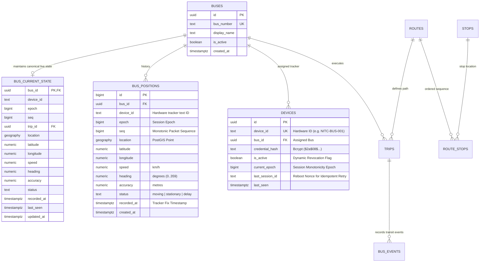
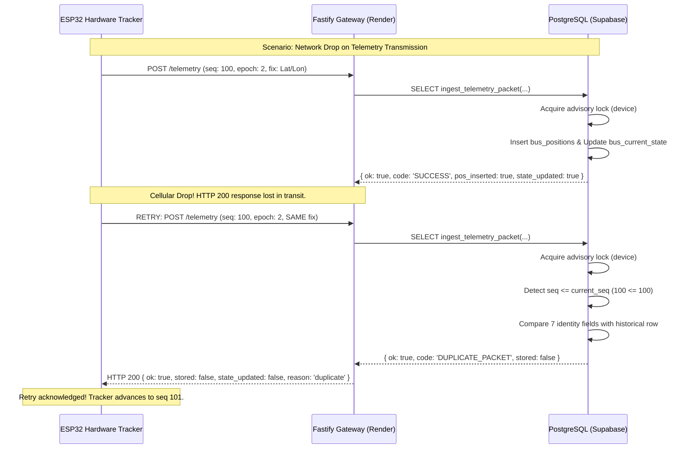

# Tracklet Backend Architecture & System Design

## 1. System Overview

Tracklet is a fixed-campus college transit tracking platform for the National Institute of Technology Calicut (NITC). The backend provides a hardened, low-latency telemetry ingestion gateway and API layer designed to ingest continuous GPS fixes from hardware bus trackers (ESP32 microcontrollers with GNSS modules), validate and persist telemetry atomically into PostgreSQL, and synchronize live bus state to student and driver mobile clients running the Flutter mobile application.

```mermaid
flowchart TD
    subgraph Edge ["Hardware Trackers"]
        ESP32["ESP32 Cellular Tracker<br/>(Bcrypt Auth, Session Epoch, Seq Counter)"]
    end

    subgraph Gateway ["Fastify API Gateway (Node.js 22 on Render)"]
        AuthRoute["POST /api/v1/auth/device<br/>(JWT Issuance)"]
        ResetRoute["POST /api/v1/auth/reset-session<br/>(Idempotent Epoch Negotiation)"]
        TelemRoute["POST /api/v1/telemetry<br/>(Validation, Pre-filter, Rate Limit)"]
        BusesRoute["GET /api/v1/buses/nearby<br/>(Spatial Discovery)"]
        TripsRoute["POST /api/v1/trips/:id/end<br/>(Trip Lifecycle)"]
    end

    subgraph Database ["Supabase PostgreSQL (PostGIS & Row Locks)"]
        RPC_Ingest["RPC: ingest_telemetry_packet()<br/>- Advisory Lock (device_id)<br/>- Row Lock (bus_current_state)<br/>- Multi-field Idempotent Dedup<br/>- Canonical Spatial & State Update"]
        RPC_Reset["RPC: reset_device_sequence()<br/>- Bcrypt Verify via pgcrypto<br/>- Idempotent Session Reset<br/>- Sequence Monotonicity Guard"]
        Tables_Hist[("bus_positions<br/>(Historical Telemetry)")]
        Tables_State[("bus_current_state<br/>(Live Canonical State)")]
        Tables_Meta[("buses / devices / trips / stops")]
    end

    subgraph Realtime ["Supabase Realtime"]
        RT_Pub["Realtime Publication<br/>(supabase_realtime)"]
    end

    subgraph Clients ["Flutter Mobile Clients"]
        FlutterApp["Student & Driver App<br/>(Live Map, Realtime WebSocket)"]
    end

    ESP32 -->|Bcrypt credentials| AuthRoute
    ESP32 -->|Session reboot handshake| ResetRoute
    ESP32 -->|Stream GPS (seq, epoch, fix)| TelemRoute
    ResetRoute -->|Execute| RPC_Reset
    TelemRoute -->|Atomic write| RPC_Ingest
    RPC_Ingest -->|Insert history| Tables_Hist
    RPC_Ingest -->|Upsert live position| Tables_State
    Tables_State -->|WAL CDC Events| RT_Pub
    RT_Pub -->|WebSocket Stream| FlutterApp
    FlutterApp -->|REST Queries| BusesRoute
```

### End-to-End Request Lifecycles

1. **Tracker Boot Session Lifecycle**:
   - The ESP32 tracker boots, connects to cellular network, and generates a boot nonce `session_id`.
   - Sends `POST /api/v1/auth/reset-session` with its hardware `device_id`, configured `secret`, and `session_id`.
   - Fastify forwards this request to PostgreSQL's `reset_device_sequence` RPC.
   - PostgreSQL verifies the Bcrypt credential hash using `pgcrypto` `crypt()`. If the request is retried with the same `session_id` (e.g. cellular dropped the HTTP response), PostgreSQL recognizes the session and idempotently returns the established epoch without incrementing.
   - The device caches the negotiated `epoch` and initializes its sequence counter `seq = 1`.
2. **Telemetry Ingestion Lifecycle**:
   - The ESP32 acquires a GPS fix and calls `POST /api/v1/telemetry` presenting its JWT and packet `{ device_id, seq, epoch, timestamp, latitude, longitude, speed, heading, accuracy }`.
   - Fastify validates the JWT, checks that `devices.is_active = true` in PostgreSQL, runs syntactic schema checks (TypeBox), bounds checks (NITC corridor `[11.2, 11.45]` lat, `[75.8, 76.1]` lon), and implied-speed anomaly detection.
   - Fastify executes `ingest_telemetry_packet(...)` on PostgreSQL with the service-role client.
   - PostgreSQL acquires a transaction-scoped advisory lock on `hashtext(device_id)`, locks the bus state row with `FOR UPDATE`, enforces strict sequence monotonicity within the session epoch, verifies exact 7-field equality for idempotent duplicate retries, and atomically writes the position to `bus_positions` and `bus_current_state`.
   - PostgreSQL evaluates stop geofences (`st_dwithin`), arrival debouncing, departure hysteresis, and route deviation.
   - `bus_current_state` emits a change event via PostgreSQL Write-Ahead Log (WAL) to Supabase Realtime, immediately streaming the updated marker coordinates to active Flutter mobile maps.
3. **Flutter Client Query Lifecycle**:
   - Static transit information (stops, routes, schedules) and user preferences are read directly from Supabase via RLS-protected queries or cached locally on device.
   - Nearby buses are queried via `GET /api/v1/buses/nearby?lat=...&lon=...&radius=2000`, invoking canonical PostGIS spatial RPC `get_nearby_buses`.
   - Live location updates stream continuously over Supabase Realtime WebSocket subscription on `bus_current_state`.

---

## 2. Component Responsibilities & Directory Architecture

| Directory / Layer | Primary Responsibility | Authoritative Boundary |
|---|---|---|
| `src/routes/` | HTTP request routing, status code mapping, parameter unpacking, and serialization. | HTTP layer only. Maps database response codes (`SUCCESS`, `DUPLICATE_PACKET`, `SEQUENCE_REUSE_CONFLICT`, etc.) to HTTP 200, 401, 409, 422. |
| `src/schemas/` | TypeBox validation schemas for request bodies, query parameters, path params, and responses. | Rejects malformed JSON, unknown fields, out-of-range types, and enforces minimum secret lengths before handlers execute. |
| `src/services/` | Pure business logic, normalization, and stateless validation: coordinate boundaries, clock drift skew, status derivation (`moving` vs `stationary`), heading wrap (`360 -> 0`). | In-flight sanity checking. Does NOT replace database-authoritative sequence locking. |
| `src/repositories/` | Typed interfaces to Supabase RPCs and tables using the service-role client. | Marshals data between TypeScript models and PostgreSQL function parameters. |
| `src/plugins/` | Fastify plugins for JWT authentication (`auth.ts`), rate limiting, CORS, and Helmet headers (`security.ts`). | Dynamic device deactivation enforcement; per-device / per-IP rate limit key generation; RFC1918 proxy header trust. |
| `src/lib/` | Reusable utilities: Bcrypt password hashing (`password.ts`), Supabase client instantiation (`supabase.ts`), Prometheus metrics (`metrics.js`). | Standardizes 8-round Bcrypt hashes with `$2a$` prefix matching `pgcrypto`. |
| `scripts/` | Administrative CLI scripts (`provision-device.ts`). | Generates high-entropy device secrets (32-char base64url) and initializes device records. |
| `test/` | Vitest automated test suites: unit tests (`core.test.ts`), route integration tests (`auth.route.test.ts`, `telemetry.route.test.ts`, `reset_session.test.ts`, `security.test.ts`). | Fast, hermetic, mocked testing of application error mapping and business rules. |
| `test/integration/` | Real Fastify-to-Supabase integration tests (`supabase.integration.test.ts`) executed against isolated local database. | Proves end-to-end HTTP-to-SQL integration across real RPCs, locks, and constraints. |

---

## 3. Data Model & Database Architecture



### Key Data Invariants

1. **Hardware Text ID vs Internal UUID**:
   - `devices.id` is the internal primary key UUID.
   - `devices.device_id` is the hardware tracker text ID (e.g. `'NITC-BUS-001'`).
   - Fastify JWT `sub` stores the text ID. The hardware tracker never needs to know internal database UUIDs.
   - `ingest_telemetry_packet(p_device_id text)` accepts the text ID, resolves `v_device_pk` and `v_bus_id` internally, and stores the text ID in both `bus_positions.device_id` and `bus_current_state.device_id`.
2. **Packet Identity & Deduplication**:
   - Every telemetry packet is uniquely identified by `(device_id, epoch, seq)`.
   - Backed by PostgreSQL unique constraint: `uq_bus_positions_device_epoch_seq`.
3. **Single Active Device per Bus**:
   - A unique partial index `idx_devices_single_active_bus` on `devices (bus_id) WHERE (is_active = true)` strictly prevents multiple active physical hardware trackers from writing to the same bus simultaneously.
4. **Historical Isolation vs Live State**:
   - `bus_positions` is an append-only time-series ledger of all accepted coordinates.
   - `bus_current_state` contains exactly one row per bus representing the canonical instantaneous location, enrolled in `supabase_realtime`.

---

## 4. Database RPC Contract Specification

| Function Name | Purpose | Arguments | Return Structure | Calling Code |
|---|---|---|---|---|
| `ingest_telemetry_packet` | Ingests GPS packet, validates bounds, sequence, and epoch under advisory locks, dedups, and updates live state and history atomically. | `p_device_id text`<br/>`p_seq bigint`<br/>`p_timestamp timestamptz`<br/>`p_latitude numeric`<br/>`p_longitude numeric`<br/>`p_speed numeric DEFAULT NULL`<br/>`p_heading numeric DEFAULT NULL`<br/>`p_accuracy numeric DEFAULT NULL`<br/>`p_status text DEFAULT NULL`<br/>`p_stop_radius_m double precision DEFAULT 50.0`<br/>`p_deviation_m double precision DEFAULT 500.0`<br/>`p_epoch bigint DEFAULT NULL` | `jsonb`<br/>Success: `{ ok: true, code: 'SUCCESS', bus_id, trip_id, device_id, epoch, seq, pos_inserted: bool, state_updated: bool, events: [] }`<br/>Duplicate: `{ ok: true, code: 'DUPLICATE_PACKET', stored: false, bus_id, trip_id, events: [] }`<br/>Conflict: `{ ok: false, code: 'SEQUENCE_REUSE_CONFLICT' | 'STALE_EPOCH_PACKET' | 'OUT_OF_ORDER_PACKET', ... }` | `src/repositories/telemetry.repo.ts` (`ingestTelemetry`) |
| `reset_device_sequence` | Authenticates device reboot, resets sequence counter to 0, and advances session epoch. Retries with same `session_id` are idempotent. | `p_device_id text`<br/>`p_secret text`<br/>`p_session_id text DEFAULT NULL`<br/>`p_reason text DEFAULT 'firmware_reboot'` | `jsonb`<br/>New Session: `{ ok: true, code: 'SUCCESS', device_id, bus_id, new_epoch: N, idempotent_retry: false }`<br/>Retry: `{ ok: true, code: 'SUCCESS', device_id, bus_id, epoch: N, idempotent_retry: true }`<br/>Failure: `{ ok: false, code: 'INVALID_CREDENTIALS', ... }` | `src/routes/auth.ts` (`POST /api/v1/auth/reset-session`) |
| `register_tracking_device` | Administrative registration or bus reassignment of a tracking device with Bcrypt hash. | `p_device_id text`<br/>`p_bus_number text`<br/>`p_secret text`<br/>`p_allow_reassign boolean DEFAULT false` | `jsonb`<br/>`{ ok: true, code: 'SUCCESS', device_pk, device_id, bus_id, epoch }` | Supabase migration seed / admin tooling |
| `get_nearby_buses` | Spatial query returning buses within specified radius of coordinates. | `p_latitude double precision`<br/>`p_longitude double precision`<br/>`p_radius_meters double precision DEFAULT 2000`<br/>`p_limit integer DEFAULT 10` | `TABLE(bus_id uuid, bus_number text, display_name text, distance_meters double precision, ...)` | `src/routes/buses.ts` (`GET /api/v1/buses/nearby`) |
| `get_nearby_stops` | Spatial query returning campus stops within specified radius. | `p_latitude double precision`<br/>`p_longitude double precision`<br/>`p_radius_meters double precision DEFAULT 500`<br/>`p_limit integer DEFAULT 10` | `TABLE(stop_id uuid, name text, code text, distance_meters double precision, ...)` | Student / Driver app discovery |
| `get_active_bus_positions` | Reads active bus positions with freshness classifications (`fresh < 90s`, `stale < 15m`, `unavailable > 15m`). | None | `TABLE(bus_id uuid, bus_number text, latitude double precision, longitude double precision, freshness text, ...)` | Flutter initial map load |

---

## 5. Security Architecture & Trust Boundaries

1. **Service-Role Key Protection**:
   - The Supabase `service_role` key bypasses PostgreSQL Row Level Security (RLS) and possesses execution privileges on `SECURITY DEFINER` ingestion functions.
   - It is strictly configured in server-side environment variables on Render (`SUPABASE_SERVICE_ROLE_KEY`) and is **never** embedded in mobile clients, public repositories, or ESP32 firmware.
2. **Cryptographic Device Credentials**:
   - Standardized exclusively on **Bcrypt with 8 salt rounds**.
   - `src/lib/password.ts` produces hashes with the `$2a$` prefix, ensuring 100% binary compatibility with PostgreSQL `pgcrypto` `gen_salt('bf', 8)`.
   - 16-character minimum secret length is enforced across Fastify TypeBox schemas (`minLength: 16`), database functions, and provisioning scripts.
3. **Dynamic Token Invalidation**:
   - Fastify signs 12-hour device JWTs (`sub: device_id`).
   - The `authenticateDevice` pre-handler in `src/plugins/auth.ts` dynamically queries `devices.is_active` for each telemetry request. Deactivated devices are rejected with HTTP 401 immediately, without waiting for the JWT to expire.
4. **Reverse Proxy Trust & IP Spoofing Prevention**:
   - Configured with `trustProxy: config.trustedProxies` specifying private RFC1918 subnets (`127.0.0.1, 10.0.0.0/8, 172.16.0.0/12, 192.168.0.0/16`).
   - Render terminates external TLS and forwards requests across its internal `10.x.x.x` network. Fastify inspects the internal proxy hop without trusting external client-supplied `X-Forwarded-For` headers.
   - For authenticated routes (`/telemetry`), rate limiting is keyed on `req.user.sub` (device identifier), preventing trackers from bypassing rate limits by rotating IP addresses.
5. **Sensitive Field Redaction**:
   - Fastify logger is configured with `redact: ['req.headers.authorization']`. Device secrets in request bodies are never logged.

---

## 6. Consistency & Distributed-System Failure Handling



### Known Architectural Limitation: Sequential Trip Completion

In `src/routes/trips.ts`, the trip ending operation `/trips/:id/end` executes three sequential database calls:
1. `trips` table updated to `status = 'completed'` and `ended_at = now()`.
2. `bus_events` table receives an insert with `event_type = 'trip_ended'`.
3. `bus_current_state` table is updated with `trip_id = null`.

These operations are sequential REST calls executed by Fastify rather than a single atomic PostgreSQL transaction. If the Node.js process is terminated mid-sequence, the trip will be marked completed while `bus_current_state.trip_id` may remain populated until the subsequent telemetry packet arrives and evaluates active trips.

**Future Remediation**: Implement an atomic `end_bus_trip(p_trip_id uuid)` PostgreSQL RPC in a future database migration to wrap these three updates in a single ACID transaction.
