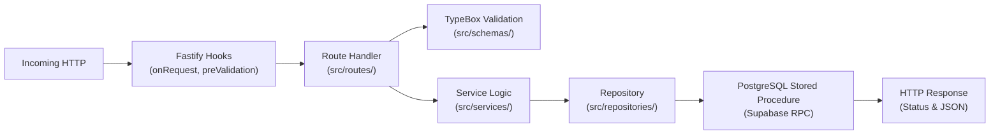

# Tracklet Backend Implementation & Developer Extension Guide

## 1. Request Lifecycle & Layer Ownership

Every incoming HTTP request traverses a clean, single-direction pipeline:



### Layer Ownership Rules
1. **HTTP Status Codes live ONLY in `src/routes/`**: Services and repositories must return typed domain results or throw standard errors; they must never return HTTP status numbers.
2. **PostgreSQL is Authoritative for Concurrency**: Never implement in-memory maps, caches, or state variables for packet sequence ordering, deduplication, or bus location. PostgreSQL advisory locks and row locks are the single source of truth.
3. **Schemas Enforce Invariants Early**: Validate payload types, length constraints, and formats in `src/schemas/` before execution reaches business logic.

---

## 2. Concrete Walkthrough: Adding a New Feature End-to-End

To illustrate how to safely implement changes across all layers, here is a complete walkthrough of adding a hypothetical endpoint: `POST /api/v1/buses/:id/emergency-stop`.

### Step 1: Define TypeBox Schemas (`src/schemas/bus.ts`)
```typescript
import { Type, type Static } from '@sinclair/typebox';

export const EmergencyStopParams = Type.Object({
  id: Type.String({ format: 'uuid' }),
});

export const EmergencyStopBody = Type.Object({
  reason: Type.String({ minLength: 3, maxLength: 200 }),
}, { additionalProperties: false });

export const EmergencyStopResponse = Type.Object({
  ok: Type.Literal(true),
  bus_id: Type.String({ format: 'uuid' }),
  stopped_at: Type.String({ format: 'date-time' }),
});
```

### Step 2: Implement Database Function Migration (`NITC_BUS_TRACKING_APP/supabase/migrations/`)
```sql
CREATE OR REPLACE FUNCTION public.set_bus_emergency_stop(
  p_bus_id uuid,
  p_reason text
)
RETURNS jsonb
LANGUAGE plpgsql
SECURITY DEFINER
SET search_path = public, extensions, pg_temp
AS $$
BEGIN
  UPDATE public.bus_current_state
  SET status = 'emergency_stop', updated_at = now()
  WHERE bus_id = p_bus_id;

  INSERT INTO public.bus_events (bus_id, event_type, metadata)
  VALUES (p_bus_id, 'emergency_stop', jsonb_build_object('reason', p_reason));

  RETURN jsonb_build_object('ok', true, 'bus_id', p_bus_id, 'stopped_at', now());
END;
$$;
```

### Step 3: Implement Repository Interface (`src/repositories/buses.repo.ts`)
```typescript
import { supabase } from '../lib/supabase.js';

export async function setBusEmergencyStop(busId: string, reason: string) {
  const { data, error } = await supabase.rpc('set_bus_emergency_stop', {
    p_bus_id: busId,
    p_reason: reason,
  });
  if (error) throw new Error(`set_bus_emergency_stop: ${error.message}`);
  return data;
}
```

### Step 4: Wire Route Handler with Authentication (`src/routes/buses.ts`)
```typescript
app.post(
  '/buses/:id/emergency-stop',
  {
    onRequest: [app.authenticateUser, app.requireRole('admin', 'dispatcher')],
    schema: {
      params: EmergencyStopParams,
      body: EmergencyStopBody,
      response: { 200: EmergencyStopResponse },
    },
  },
  async (req, reply) => {
    const { id } = req.params;
    const { reason } = req.body;
    const result = await setBusEmergencyStop(id, reason);
    return reply.code(200).send(result);
  },
);
```

### Step 5: Add Unit & Integration Tests
1. **Mocked Route Test (`test/buses.route.test.ts`)**:
   - Verify unauthenticated caller receives 401.
   - Verify user without `'admin'` role receives 403.
   - Verify invalid UUID parameter receives 400.
2. **Real Database Integration Test (`test/integration/supabase.integration.test.ts`)**:
   - Call the endpoint against local Supabase.
   - Assert `bus_current_state.status = 'emergency_stop'`.
   - Assert `bus_events` has row with event `'emergency_stop'`.

---

## 3. Backward Compatibility & Future Migrations

While the current deployment had no legacy production users, future updates will have active provisioned devices:

1. **Schema Evolution Guidelines**:
   - Never remove or rename columns in `bus_positions` or `bus_current_state` without a phased deployment.
   - For new RPC arguments, always provide a SQL `DEFAULT NULL` or safe default so existing callers do not break.
2. **Credential Migrations**:
   - Bcrypt hashes stored as `$2a$08$...` are standard. If moving to Argon2id in the future, follow a dual-read lazy-upgrade strategy (verify Bcrypt, re-hash with Argon2 upon successful login).
3. **Session Epoch Invariance**:
   - The epoch monotonicity contract (`seq` restarts only with `epoch + 1`) must remain preserved across all future firmware or API updates.

---

## 4. Pre-Commit & Pre-PR Verification Checklist

Before opening a PR or merging code, every developer must execute this checklist:

- [ ] **Typecheck**: `npm run typecheck` exits with 0 compiler diagnostics.
- [ ] **Unit Tests**: `npm test` passes 100% of hermetic unit and mocked route tests.
- [ ] **Real Integration Tests**: `npm run test:integration` passes against isolated local Supabase.
- [ ] **Production Build**: `npm run build` succeeds and produces clean output in `dist/`.
- [ ] **No Secrets Exposed**: Verified no API keys, tokens, device secrets, or `.env` files are staged.
- [ ] **Git Working Tree Clean**: `git status --short` shows no unintended modifications or build artifacts.
- [ ] **Changelog Maintained**: Documented phase changes in `docs/telemetry-integration-changelog.md`.
- [ ] **PR Description Updated**: Updated `docs/pr-description.md` with exact commit hashes and test results.
